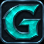

# Gogatki

Panel dodatków do Margonem na SI i NI, ze wspólnym dockiem i zapisem ustawień.

**[Zainstaluj Gogatki](https://raw.githubusercontent.com/KoniecDniaDziecka/Gogatki/main/gogatki/gogatki.user.js)**

Wymagany [Tampermonkey](https://www.tampermonkey.net/).

Po instalacji odśwież grę.
